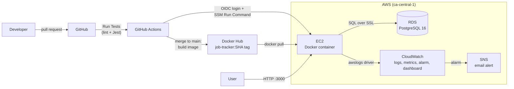

# Job Tracker

A job application tracker built end to end: a Node.js/Express API and plain JavaScript frontend, PostgreSQL on Amazon RDS, containerized with Docker, tested and deployed automatically with GitHub Actions, and monitored with CloudWatch.

Track each application's company, role, date, status (applied, interview, offer, rejected) and notes, filter by status, and see a running summary of where every application stands.

The goal of this project was to practise the full application lifecycle, not just the code: **build → test → package → deploy → run → monitor**.

## Architecture



## Tech stack

| Area | Tools |
|---|---|
| Backend | Node.js 22, Express 5, `pg`, `pino` (structured logging) |
| Frontend | HTML, CSS, vanilla JavaScript (served by Express) |
| Database | PostgreSQL 16 (Docker locally, Amazon RDS in production) |
| Testing | Jest, Supertest, ESLint |
| Containers | Docker, Docker Compose |
| CI/CD | GitHub Actions, Docker Hub, act (local workflow runs) |
| AWS | EC2, RDS, IAM (OIDC), Systems Manager, CloudWatch, SNS |
| Dev environment | Devbox, Task |

## CI/CD pipeline

Three workflows in `.github/workflows/`:

**1. Run Tests** (`test.yaml`): runs on every pull request and on pushes to `main` that touch app or test code. Installs dependencies with `npm ci` (with npm caching), then runs `task check` (ESLint + Jest). `main` is protected by a ruleset: changes go through pull requests, and a PR can't merge until this check passes.

**2. Build and Push Container Images** (`build-push.yaml`): runs when a merge to `main` changes anything that goes into the image. Builds with Docker Buildx (layer cache stored in GitHub's cache), pushes to Docker Hub tagged with the commit SHA and `latest`, then triggers the deploy with the new SHA.

**3. Deploy to EC2** (`deploy.yaml`): can also be run by hand with any SHA, which doubles as a rollback.
- Logs in to AWS with **OIDC**: GitHub proves the workflow's identity, and AWS issues short-lived credentials for a role that only trusts this repository's `main` branch. No AWS keys are stored in GitHub.
- Uses **SSM Run Command** to pull the image and replace the container on the instance, so the instance doesn't need SSH open to GitHub.
- Waits for the command and fails the workflow if anything failed on the instance, including a post-deploy `/health` check.
- Uses a `concurrency` group so two deploys never run at once.

Each workflow has a folder (`.github/workflows/<name>/`) with a Taskfile and event file for running it locally with [act](https://github.com/nektos/act) before pushing.

## AWS setup

| Resource | Configuration |
|---|---|
| EC2 | Runs the container with `--restart unless-stopped`. Security group allows SSH from my IP only (plus EC2 Instance Connect's managed prefix list) and port 3000 for the app |
| RDS | PostgreSQL 16, not publicly accessible. Its security group only accepts connections from the EC2 instance. SSL required |
| Instance IAM role | `AmazonSSMManagedInstanceCore` (for SSM) and an inline policy allowing writes to the `job-tracker-logs` log group only |
| GitHub deploy role | Trusted only by this repo's `main` branch via OIDC. Inline policy allows `ssm:SendCommand` on this one instance with `AWS-RunShellScript`, plus reading command results |
| Configuration | Database credentials live in an env file on the instance, passed to the container with `--env-file`; nothing secret is in the image or the repository |

Every role and security group follows least privilege: each grants only what that component needs.

## Logging and monitoring

**Structured logging.** The app logs JSON with `pino`. A request middleware gives every request an ID (returned to the client in an `X-Request-Id` header) and writes one line per request with the method, path, status code and duration. Errors are logged with their stack trace and the same request ID.

```json
{"level":"info","time":"2026-11-24T05:33:19.401Z","service":"job-tracker","env":"production","requestId":"5e5c41d5-...","method":"GET","path":"/api/applications","statusCode":200,"durationMs":3.2,"msg":"request completed"}
```

**CloudWatch.** Docker's `awslogs` log driver ships the container's output to the `job-tracker-logs` log group, where it can be queried with Logs Insights. Metric filters turn log lines into metrics:

| Metric | Filter | Value |
|---|---|---|
| `ServerErrors` | `{ $.msg = "request completed" && $.statusCode >= 500 }` | 1 |
| `RequestCount` | `{ $.msg = "request completed" }` | 1 |
| `Latency` | `{ $.msg = "request completed" }` | `$.durationMs` |

**Alerting.** A CloudWatch alarm emails me through SNS when there are 3 or more server errors in 5 minutes.

**Dashboard.** Traffic and errors, p50/p95 latency, EC2 and RDS CPU, and database connections: the four golden signals of traffic, errors, latency and saturation.

## Running it locally

Requirements: [Devbox](https://www.jetify.com/devbox) and Docker. Devbox installs everything else (Node 22, the Postgres client, Task, act, the GitHub CLI) at the versions in `devbox.json`.

```bash
devbox shell        # enter the project's environment
task setup          # npm install + create .env from .env.example
task dev            # start Postgres in Docker, then the app with auto-restart
```

Open http://localhost:3000. On first start, Postgres runs `db/schema.sql` automatically to create the table.

| Command | What it does |
|---|---|
| `task dev` | Postgres in Docker (waits until healthy) + app on your machine with auto-restart |
| `task up` / `task down` | Whole stack (app + database) in Docker Compose |
| `task check` | Lint and tests, same as CI |
| `task test` / `task lint` | Tests or lint on their own |
| `task db:start` / `task db:stop` | Start or stop the local database (data is kept in a Docker volume) |
| `task --list` | Every available task |

## Testing

Jest and Supertest test the API by sending real HTTP requests to the Express app without starting a server. The database module is mocked, so the tests run anywhere, including GitHub Actions, without Postgres. The tests cover validation, status codes, parameterized SQL (no string-built queries), and the stats logic that fills in statuses with zero applications.

## API

| Method | Path | Body | Returns |
|---|---|---|---|
| GET | `/health` | | `{ "status": "ok" }` (doesn't touch the database) |
| GET | `/api/applications?status=…` | | Array of applications, optionally filtered |
| POST | `/api/applications` | `company`, `role`, optional `status`, `applied_on`, `link`, `notes` | 201 + the new row |
| PATCH | `/api/applications/:id` | `{ "status": "interview" }` | The updated row |
| DELETE | `/api/applications/:id` | | 204 |
| GET | `/api/stats` | | `{ "applied", "interview", "offer", "rejected", "total" }` |

## Configuration

The app reads everything from environment variables, so the same image runs locally, in Compose and on AWS. See `.env.example`.

| Variable | Local | Compose | AWS |
|---|---|---|---|
| `DB_HOST` | `localhost` | `database` (service name) | RDS endpoint |
| `DB_PORT` / `DB_USER` / `DB_PASSWORD` / `DB_NAME` | defaults in `.env.example` | set in `docker-compose.yaml` | env file on the instance |
| `DB_SSL` | `false` | `false` | `true` |
| `LOG_LEVEL` | `info` | `info` | `info` |
| `APP_ENV` | `local` | `local` | `production` |

## Project layout

```
.
├── src/
│   ├── server.js               starts the server, handles graceful shutdown
│   ├── app.js                  builds the Express app (tests import this)
│   ├── db.js                   Postgres connection pool, configured by env vars
│   ├── logger.js               pino logger (JSON output)
│   ├── routes/                 applications (CRUD) and stats
│   ├── middleware/             request logging/IDs and error handling
│   └── scripts/initDb.js       applies db/schema.sql to any database
├── public/                     frontend, served by Express
├── db/schema.sql               the applications table
├── tests/app.test.js           API tests
├── Dockerfile                  production image (slim base, prod deps only, non-root user)
├── .dockerignore               allowlist: only what the image needs
├── docker-compose.yaml         app + Postgres for local development
├── Taskfile.yaml               project commands
├── devbox.json                 pinned dev tools
└── .github/workflows/          test, build-push and deploy workflows (+ act configs)
```

## Notes and lessons learned

- **The image is built once and configured at runtime.** It contains no settings or secrets. Only the environment variables change between local, Compose and AWS.
- **"Running" isn't "ready."** Postgres accepts connections a few seconds after its container starts. A `pg_isready` healthcheck with `depends_on: condition: service_healthy` (and `docker compose up --wait`) fixed early connection failures.
- **OIDC subject format.** The first automated deploy failed with `Not authorized to perform sts:AssumeRoleWithWebIdentity` even though the trust policy looked right. Decoding the token's claims in the workflow showed GitHub's subject includes immutable owner and repository IDs (`repo:owner@<id>/repo@<id>:ref:refs/heads/main`), which also protects against a deleted repo's name being reused. Updating the trust policy to match fixed it.
- **Count metrics need the Sum statistic.** A metric filter publishes 1 per match and 0 otherwise, so alarming on Average can hide real events.
- **Percentiles over averages for latency.** p95 shows what slower users experience; an average lets a few slow requests hide behind many fast ones.

## License

[MIT](LICENSE)
